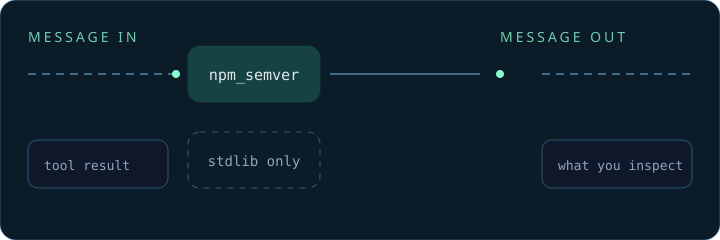

<p align="center">
  
</p>

<p align="center">
  <a href="https://pypi.org/project/npm-semver/"></a>
  <a href="https://pypi.org/project/npm-semver/"></a>
  <a href="https://pypi.org/project/npm-semver/"></a>
  <a href="https://github.com/sandeshbagmare/npm-semver/actions/workflows/ci.yml"></a>
  <a href="https://github.com/sandeshbagmare/npm-semver/blob/main/LICENSE"></a>
  <a href="https://sandeshbagmare.github.io/npm-semver/"></a>
  <a href="https://pypi.org/project/npm-semver/"></a>
</p>

<h3 align="center">npm semver ranges, parsed the way npm parses them</h3>
<p align="center"><em>Standard library only. No runtime dependencies. Python 3.9+.</em></p>

<p align="center">
  
</p>

## Install

```console
pip install npm-semver
```

## Use

```python
from npm_semver import (
    InvalidRange,
    InvalidVersion,
    max_satisfying,
    min_satisfying,
    filter_satisfying,
    parse,
    parse_range,
    satisfies,
    sort_versions,
)

satisfies("1.2.3", ">=1.2.0 <2.0.0")  # True
satisfies("1.0.0-rc.1", "^1.0.0")  # False, prerelease needs its own comparator
satisfies("2.1.0", "1.x || >=2.0.0")  # True

sort_versions(["2.0.0", "1.0.0-rc.1", "1.0.0"])
# [Version(1, 0, 0, ('rc', '1')), Version(1, 0, 0), Version(2, 0, 0)]

max_satisfying(["1.9.9", "2.0.0"], "^1.2.0")  # Version(1, 9, 9)
min_satisfying(["1.4.2", "1.9.9"], "^1.2.0")  # Version(1, 4, 2)
filter_satisfying(["1.0.0", "1.4.2", "2.0.0"], ">=1.1.0")  # [Version(1, 4, 2), Version(2, 0, 0)]

parse_range("1.2.3 - 2.0")  # ((('>=', Version(1, 2, 3)), ('<', Version(2, 1, 0))),)
parse("v1.2.3-beta.1+sha.abc").prerelease  # ('beta', '1')
```

Anything a range cannot express raises `InvalidRange`; anything that is not a
version raises `InvalidVersion`. Both subclass `ValueError`.

## Supported range syntax

| form | example | means |
| ---- | ------- | ----- |
| exact | `1.2.3` | `=1.2.3` |
| caret | `^1.2.3`, `^0.2.3`, `^1`, `^0` | compatible with, stopping at the next left-most non-zero part |
| tilde | `~1.2.3`, `~1.2`, `~1` | patch level, or minor level for a partial version |
| comparison | `>`, `>=`, `<`, `<=`, `=` | with partial-version semantics |
| wildcard | `*`, `1.x`, `1.2.X` | the whole line |
| partial | `1.2`, `1` | the whole minor or major |
| hyphen | `1.2.3 - 2.0` | inclusive on both sides, upper bound widened if partial |
| union | `1.x \|\| >=2.0.0` | any branch |
| conjunction | `>=1.2.0 <2.0.0`, `>=1.2.0, <2.0.0` | all comparators |

Build metadata (`+sha`) is parsed and printed but ignored in comparisons, as
semver requires.

## Compatibility

`npm-semver` deliberately does not read PEP 440 ranges (`~=1.2`, `==1.*`,
epochs). If you need those, use `packaging`. Ranges here are npm's, which is what
JavaScript ecosystems, lockfiles and `package.json` emit.

## Development

```console
python -m venv .venv
.venv/bin/pip install -e ".[test]"
.venv/bin/pytest
```

The suite covers every line of the package (`pytest --cov --cov-branch`), and the
examples in the docstrings run as tests through `--doctest-modules`.

## License

MIT.
